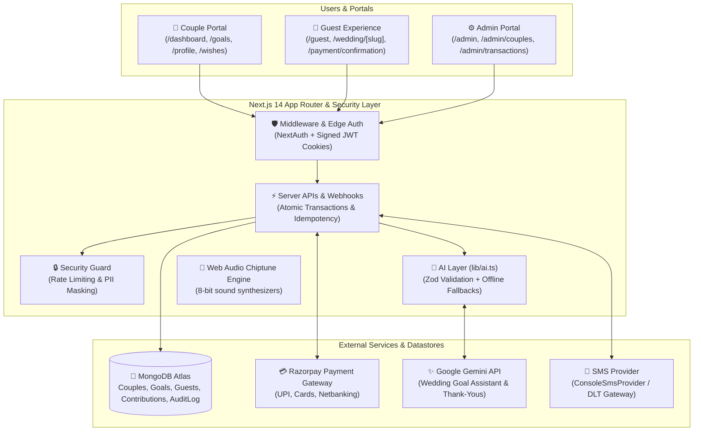

# 💌 The Wedding Wish

> *"A Little Shagun. A Lifetime of Dreams."*

The Wedding Wish is a full-stack, AI-powered wedding registry web application built for Indian couples and their guests. It modernises the traditional Indian "shagun" custom (gifting cash in a *lifafa* envelope or giving repetitive appliances) by enabling couples to list real life goals (e.g. Europe Honeymoon ₹1,50,000, First Home Downpayment ₹1,00,000, Dream Kitchen ₹40,000) and share them via an 8-character Wedding Code and retro pixel QR code.

The entire product is styled as an authentic **16-bit nostalgic retro 2D pixel-art wedding video game** with chiptune sound synthesis, stepped animations, and strict cultural design sensibilities.

---

## 🏛️ System Architecture



---

## 🎨 Design System & Color Palette

The interface adheres strictly to a 6-token retro palette with hard 2–4px solid borders, stepped shadows, and pixelated font typography (`Press Start 2P` headings + `VT323` body text):

| Token | Hex | Role |
| :--- | :--- | :--- |
| **`cream`** | `#FFF7F2` | Primary background, clean paper canvas |
| **`soft-blush`** | `#F7E9E5` | Card backgrounds, subtle highlighted zones |
| **`blush`** | `#EBCACA` | Borders, secondary badges, soft accents |
| **`rose-dusty`** | `#D8A7A7` | Primary buttons, active highlights, shagun envelope |
| **`vintage`** | `#9C5968` | Secondary buttons, subtitles, progress bars |
| **`deep`** | `#75404F` | High-contrast text, 4px solid borders, heavy retro shadows |

---

## 🔒 Non-Negotiable Engineering Rules

1. **Integer Paise Financial Storage**: All monetary values are strictly stored as integer paise (`₹1 = 100 paise`). Formatted displays use Indian number grouping (e.g. `₹1,50,000`).
2. **Idempotent Payment Settlement**: Razorpay webhooks and client verification routes share the atomic `finaliseContribution` method with database status checks preventing double-counting or replayed transactions.
3. **Strict PII Confidentiality**: Guest phone numbers (+91 E.164) are visible **exclusively to the owning couple** on their authenticated dashboard and to platform administrators. They are never rendered on public endpoints or wedding pages.
4. **Server-Side Resilient AI**: Gemini 2.0 API interactions occur strictly server-side with strict Zod validation, rate limiting, and zero-downtime offline heuristic fallback generators.
5. **Autoplay-Safe Retro Audio**: Web Audio API retro chiptune chimes and fanfare only play upon user interaction and respect a persistent mute toggle stored in `localStorage`.

---

## 🚀 Key User Journeys

### 1. Couple Journey
1. **Register & Login**: Fast registration with automatic unambiguous 8-character wedding code generation (omits confusing `0, O, 1, I, L`).
2. **Dream Registry**: Set target amounts for honeymoon, house, appliances, or furniture. Use the **AI Goal Assistant** (`/ai/goals`) to generate budget-aligned categories and descriptions.
3. **Share & Invite**: Download custom pixel-bordered QR codes or share profile links across WhatsApp (`/wedding/[slug]`).
4. **Real-time Dashboard**: Track total shagun collected, goal progress bars, contributor tables, and read public wishes.
5. **One-Tap AI Thank-Yous**: Generate personalized WhatsApp messages (`wa.me` links) with one tap.

### 2. Guest Journey
1. **Wedding Access**: Arrive by scanning a QR code or entering the wedding code at `/guest` or `/`.
2. **SMS OTP Verification**: 6-digit cryptographic OTP verification with 5-minute expiry and rate-limiting.
3. **Shagun Contribution**: Pick auspicious presets (`₹501`, `₹1,001`, `₹2,001`, `₹5,001`) or enter custom amounts.
4. **Checkout & Blessing**: Complete Razorpay payment, view envelope-opening pixel animation with retro chiptune fanfare, and post a blessing on the couple's Wishes Wall.
5. **Printable Receipt**: Instant digital shagun receipt with unique transaction ID (`WW-YYYYMMDD-XXXXXX`).

### 3. Administrator Journey (`/admin`)
1. **Secure Admin Access**: Dedicated login at `/admin/login` protected by signed JWT session cookie (`ww_admin_session`).
2. **Platform KPI Overview**: Total registries, verified guests, settled shagun volume, and goal completion rates.
3. **Couple Inspector**: Search registries, inspect goals, and suspend/reactivate accounts.
4. **Transaction Ledger**: Filter real-time gateway transactions, examine dispute flags, and view order IDs.
5. **Suspicious Activity Monitor**: Real-time heuristic anomaly detection for brute-force OTP attempts and high-fail payment spikes.

---

## 🛠️ Tech Stack

- **Framework**: Next.js 14 (App Router, Server Components, API Route Handlers)
- **Language**: TypeScript
- **Database**: MongoDB with Mongoose (cached connection singleton, strict schemas)
- **Authentication**: NextAuth.js (couples) + Signed JWT cookies (guests & admins)
- **Payments**: Razorpay Node SDK (test & live mode support)
- **Styling**: Tailwind CSS with custom pixel borders and retro shadows
- **Animations**: CSS `steps()` horizontal sprite engine (`<Sprite>`, `<SpriteSequence>`) + Canvas particle hearts
- **Audio Engine**: Web Audio API real-time 8-bit chiptune sound synthesis
- **Testing**: Vitest test runner (29 passing unit & integration tests)

---

## 💻 Local Setup & Development

### 1. Prerequisites
- Node.js 18+ or 20+
- Local MongoDB running at `mongodb://localhost:27017` (or MongoDB Atlas connection string)

### 2. Environment Variables
Create a `.env.local` file in the project root:

```env
# MongoDB Connection
MONGODB_URI=mongodb://localhost:27017/wedding-wish

# NextAuth & JWT Secrets
NEXTAUTH_URL=http://localhost:3000
NEXTAUTH_SECRET=your_nextauth_secret_key_minimum_32_chars
ADMIN_JWT_SECRET=your_admin_jwt_secret_key_minimum_32_chars

# Razorpay Keys (Test mode or Live)
RAZORPAY_KEY_ID=rzp_test_placeholder
RAZORPAY_KEY_SECRET=rzp_secret_placeholder
RAZORPAY_WEBHOOK_SECRET=whsec_placeholder

# Google Gemini API Key
GEMINI_API_KEY=your_gemini_api_key

# SMS Provider ("console" for development or "twilio" / "msg91")
SMS_PROVIDER=console

# Admin Seed Credentials
ADMIN_EMAIL=admin@weddingwish.in
ADMIN_PASSWORD=Admin@123456
```

### 3. Installation & Run
```bash
# Install dependencies
npm install

# Seed the initial Superadmin account
npm run seed-admin

# Start development server
npm run dev
```

Visit:
- **Landing Page**: [http://localhost:3000](http://localhost:3000)
- **Guest Portal**: [http://localhost:3000/guest](http://localhost:3000/guest)
- **Couple Login**: [http://localhost:3000/login](http://localhost:3000/login)
- **Admin Portal**: [http://localhost:3000/admin](http://localhost:3000/admin) (Login: `admin@weddingwish.in` / `Admin@123456`)
- **Pixel UI Kit**: [http://localhost:3000/ui-kit](http://localhost:3000/ui-kit)

---

## 🧪 Testing & Database Reconciliation

```bash
# Run automated Vitest test suite
npm test

# Run read-only financial ledger audit
npm run reconcile

# Run automated healing of goal collected amounts
npm run reconcile -- --fix
```

---

## 🌐 Vercel Deployment Guide

1. **Push to GitHub**: Push this repository to your GitHub account.
2. **Import into Vercel**: Connect your GitHub repository in the Vercel Dashboard.
3. **Configure Environment Variables**:
   - `MONGODB_URI`: Your MongoDB Atlas SRV URI (`mongodb+srv://...`).
   - `NEXTAUTH_URL`: Your production domain (e.g. `https://theweddingwish.in`).
   - `NEXTAUTH_SECRET`: A secure random string (generate with `openssl rand -base64 32`).
   - `ADMIN_JWT_SECRET`: A secure random string.
   - `RAZORPAY_KEY_ID` & `RAZORPAY_KEY_SECRET`: Your live Razorpay credentials.
   - `RAZORPAY_WEBHOOK_SECRET`: Webhook secret configured on Razorpay Dashboard.
   - `GEMINI_API_KEY`: Google AI Studio API key.
   - `SMS_PROVIDER`: `console` (dev) or your real provider.
4. **Deploy**: Click **Deploy**. The build will run `next build` and generate all 30 static and dynamic routes.

---

## 📋 Pre-Launch Indian Production Checklist

- [ ] **TRAI DLT Template Registration**: Indian telecom regulations require registering SMS Principal Entity IDs and SMS Content Templates (DLT) for transactional OTPs before using production SMS gateways like MSG91 or Twilio India.
- [ ] **Razorpay KYC & Webhook URL**: Complete business KYC on Razorpay and configure the webhook URL to `https://your-domain.com/api/webhooks/razorpay` with `payment.captured` and `payment.failed` event subscriptions.
- [ ] **MongoDB Atlas IP Whitelist**: In MongoDB Atlas Network Access, ensure `0.0.0.0/0` is allowed or configure Vercel Secure Integration.
- [ ] **Custom Domain & SSL**: Configure your production custom domain with HSTS enabled (included in `next.config.mjs` security headers).

---

## 📜 License

Private & Proprietary © The Wedding Wish. All rights reserved.
